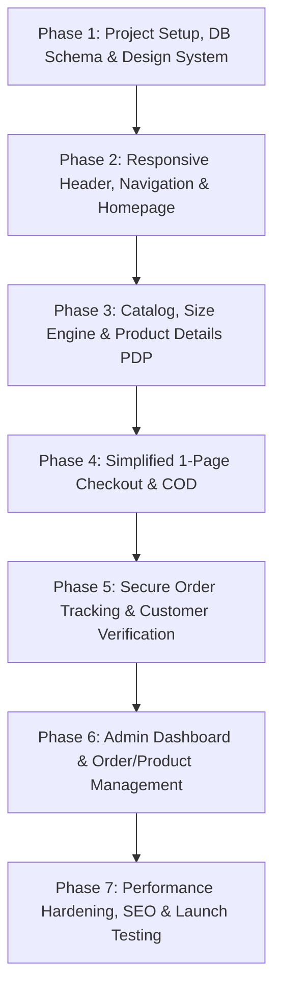

# 👗 Master E-Commerce Development Prompts: Premium Women's Fashion Store (Bangladesh)

> **Document Purpose:** This document provides a battle-tested, sequential, phase-by-phase implementation blueprint and AI prompt set to develop the complete e-commerce website specified in [`architecture.md`](file:///e:/sample%20women%20cloth%20store/architecture.md).  
> **Key Focus Areas:** Blazing performance (Core Web Vitals), flawless device responsiveness (Mobile, Tablet, Desktop), elegant Bengali typography with crisp numerals (`Hind Siliguri` / `Anek Bangla`), frictionless 1-page Cash on Delivery (COD) checkout, dynamic variant/size system, and a robust admin dashboard.

---

## 📑 Table of Contents

1. [Architectural Principles & Core Directives](#1-architectural-principles--core-directives)
2. [Design System, Typography & Device Breakpoints](#2-design-system-typography--device-breakpoints)
3. [Technology Stack & Performance Benchmarks](#3-technology-stack--performance-benchmarks)
4. [Master Execution Roadmap](#4-master-execution-roadmap)
5. [Phase 1: Project Setup, Database Schema & Design System](#phase-1-project-setup-database-schema--design-system)
6. [Phase 2: Responsive Navigation, Header & Homepage Architecture](#phase-2-responsive-navigation-header--homepage-architecture)
7. [Phase 3: Product Catalog, Variant Engine & Product Details Page (PDP)](#phase-3-product-catalog-variant-engine--product-details-page-pdp)
8. [Phase 4: Ultra-Simplified 1-Page Checkout & Order Processing](#phase-4-ultra-simplified-1-page-checkout--order-processing)
9. [Phase 5: Secure Order Tracking & Notification Engine](#phase-5-secure-order-tracking--notification-engine)
10. [Phase 6: Full Admin Management Dashboard](#phase-6-full-admin-management-dashboard)
11. [Phase 7: Performance Optimization, Security & Production Readiness](#phase-7-performance-optimization-security--production-readiness)
12. [How to Use These Prompts with Antigravity / AI Agent](#how-to-use-these-prompts-with-antigravity--ai-agent)

---

## 1. Architectural Principles & Core Directives

When implementing this application using the prompts below, every AI agent or developer MUST follow these non-negotiable architectural mandates:

1. **Real Functionality Over Static Demos:** Every form, button, calculation, filter, and transaction must be fully wired to real backend endpoints and the database. No dummy `alert()` triggers, no mock buttons, no unvalidated frontend states.
2. **Server-Side Financial & Stock Authority:** 
   - Never trust prices, totals, or delivery charges received from the client browser.
   - All line items, discounts, delivery fees, and grand totals are strictly calculated and snapshot on the server at order creation time.
   - Inventory decrements and stock checks must be transaction-safe (ACID) to prevent concurrent overselling.
3. **No Mandatory Registration:** The customer checkout journey is 100% friction-free. No forced signup, no OTP blockers, no complex multi-step forms. 
4. **Configurable Without Code Deployments:** Delivery charges (Inside Dhaka / Outside Dhaka), banners, store information, categories, and brand assets are dynamically managed via the database and Admin Dashboard. Never hardcode prices or fees.
5. **Incremental Verification:** Build phase-by-phase. Run tests, verify database migrations, check visual responsiveness on mobile viewports, and validate API responses before advancing to subsequent phases.

---

## 2. Design System, Typography & Device Breakpoints

### 2.1 Color Palette
```css
:root {
  /* Brand Luxury Palette */
  --color-primary-burgundy: #762A43; /* Dominant Brand Accent */
  --color-primary-burgundy-hover: #5E2034;
  --color-secondary-ivory: #F7F0E8;   /* Warm Luxury Background */
  --color-accent-gold: #C5A46D;       /* Badges, Stars, Borders */
  --color-accent-gold-hover: #AF8F58;

  /* Neutrals */
  --color-text-charcoal: #252525;     /* High-legibility Body Text */
  --color-text-muted: #666666;
  --color-surface-white: #FFFFFF;
  --color-background-muted: #F8F9FA;
  --color-border-subtle: #EBEBEB;

  /* Feedback */
  --color-success: #238636;
  --color-error: #D92D20;
  --color-warning: #B54708;
}
```

### 2.2 Bengali & English Typography Specification
- **Primary Bengali Font:** `Hind Siliguri` (Google Font) — Weights: 400 (Regular), 500 (Medium), 600 (SemiBold), 700 (Bold).
- **Secondary Bengali Font / Display Option:** `Anek Bangla` (Google Font) — Weights: 400, 600, 700.
- **English / Latin Font:** `Outfit` or `Plus Jakarta Sans` — Weights: 400, 500, 600, 700.
- **Bangla Digit & Price Formatting Rule:**
  * Prices must be displayed using the Bangladeshi Taka symbol (`৳`) followed by clean, nicely spaced digits (e.g., `৳ ১,৪৫০` or `৳ 1,450` based on store locale setting).
  * Always apply `font-variant-numeric: tabular-nums;` to price tags, cart items, order summaries, and phone numbers so that digits do not jitter or misalign across responsive tables and cards.
  * Use optical kerning and responsive font sizing (fluid typography with clamp) to ensure Bengali compound letters (*juktakkhor*) render without truncation or awkward line breaks.

### 2.3 Device Breakpoints & Responsiveness Matrix
| Device Category | Viewport Width | UX Requirements |
| :--- | :--- | :--- |
| **Mobile (Compact)** | 360px – 428px | 2-column product grid, sticky bottom checkout bar on PDP, touch targets ≥ 48px, slide-out drawer menu, single-column checkout. |
| **Tablet / Foldables** | 768px – 1024px | 3-column product grid, fluid filter drawer, side-by-side cart and summary, tablet-optimized admin tables. |
| **Desktop / Laptop** | 1280px – 1920px+ | 4-column product grid, sticky sticky-scroll PDP gallery, two-column checkout (form on left, live order breakdown on right), maximum container width of 1400px. |

---

## 3. Technology Stack & Performance Benchmarks

- **Framework:** Next.js 14+ (App Router, Server Components, Server Actions / Route Handlers) with TypeScript.
- **Styling:** Tailwind CSS with CSS Variables for theme tokens + custom utility plugins for Bengali typography.
- **Database:** PostgreSQL (via Prisma ORM or Drizzle ORM).
- **State Management:** Lightweight React Context / Zustand for Cart & Checkout session state.
- **Image Optimization:** Next.js `<Image />` component with WebP/AVIF formats, explicit aspect ratios (`aspect-[3/4]` for fashion portraits), responsive `sizes` attribute, and lazy loading.
- **Target Performance Metrics:**
  - Largest Contentful Paint (LCP) < 1.8s
  - First Input Delay (FID) / INP < 100ms
  - Cumulative Layout Shift (CLS) < 0.05
  - Zero heavy third-party render-blocking scripts.

---

## 4. Master Execution Roadmap



---

## Phase 1: Project Setup, Database Schema & Design System

### 🎯 Prompt 1 Copy-Paste Instruction

```markdown
### TASK: PHASE 1 — FOUNDATION SETUP, TYPOGRAPHY & RELATIONAL DATABASE SCHEMA

You are acting as the Principal Full-Stack Architect. Implement the complete foundation for a high-performance women's fashion e-commerce platform for Bangladesh according to `architecture.md`.

#### 1. Project Initialization & Dependencies
- Initialize a Next.js (App Router, TypeScript) project with Tailwind CSS.
- Configure Google Fonts for Bengali and English:
  * Load `Hind Siliguri` (subsets: `bengali`, `latin`, weights: 400, 500, 600, 700) and `Anek Bangla`.
  * Load `Outfit` or `Plus Jakarta Sans` for Latin numerals and English UI text.
  * Configure CSS font variables: `--font-siliguri`, `--font-anek`, `--font-outfit`.
  * Ensure Tailwind CSS configuration includes the design system tokens:
    - Primary Burgundy (`#762A43`), Secondary Ivory (`#F7F0E8`), Accent Gold (`#C5A46D`), Charcoal Text (`#252525`), Muted Gray (`#F8F9FA`).
    - Add utilities for `tabular-nums` and font-feature settings for Bangla typography.

#### 2. Complete Database Schema (PostgreSQL via Prisma or Drizzle)
Create the complete schema with all relations, indexes, and constraints:
1. `users`: id, name, email (unique), password_hash, role (`SUPER_ADMIN`, `ADMIN`, `STAFF`), is_active, timestamps.
2. `categories`: id, name, name_bn, slug (unique), description, image_url, display_order, is_active, parent_id (nullable for self-relation).
3. `products`: id, name, name_bn, slug (unique), sku (unique), description, description_bn, category_id, regular_price (Decimal), sale_price (Decimal, nullable), is_featured, is_active, has_size_variants (boolean), size_selection_required (boolean), seo_title, seo_description, timestamps.
4. `product_images`: id, product_id, image_url, alt_text, display_order, is_thumbnail.
5. `product_variants`: id, product_id, sku (unique), size, color, stock_quantity (int, default 0), price_adjustment (Decimal, default 0), is_active.
6. `site_settings`: key (unique string, e.g., `delivery_inside_dhaka`, `delivery_outside_dhaka`, `site_name`, `site_phone`, `announcement_bn`), value (text), description, updated_at.
7. `orders`: id, order_number (unique human-readable string, e.g., `WCS-261024-XXXX`), customer_name, customer_phone, delivery_address, delivery_city_zone (`INSIDE_DHAKA`, `OUTSIDE_DHAKA`), order_notes, subtotal (Decimal), delivery_charge (Decimal), discount_amount (Decimal, default 0), total_payable (Decimal), order_status (`PENDING`, `CONFIRMED`, `PROCESSING`, `SHIPPED`, `DELIVERED`, `CANCELLED`, `RETURNED`, `DELIVERY_FAILED`), payment_method (`CASH_ON_DELIVERY`), payment_status (`UNPAID`, `PAID`, `REFUNDED`), courier_name, tracking_code, created_at, updated_at.
8. `order_items`: id, order_id, product_id, variant_id (nullable), product_name_snapshot, variant_name_snapshot, unit_price_snapshot (Decimal), quantity (int), line_total (Decimal).
9. `order_status_history`: id, order_id, status, notes, changed_by, created_at.
10. `audit_logs`: id, user_id, action, target_entity, details (JSON), ip_address, created_at.

#### 3. Database Seed Script
Provide a seed script `prisma/seed.ts` (or equivalent) that inserts:
- Initial admin user (`admin@clothstore.com`).
- Core women's fashion categories:
  * Salwar Kameez / Three-Piece (`সালোয়ার কামিজ / থ্রি-পিস`)
  * Sarees (`শাড়ি`)
  * Burqa / Abaya (`বোরকা / আবায়া`)
  * Kurtis (`কুর্তি`)
  * New Arrivals (`নতুন কালেকশন`)
  * Special Offers (`স্পেশাল অফার`)
- Site settings with default keys: `delivery_inside_dhaka` = "80", `delivery_outside_dhaka` = "150".
- At least 6 realistic sample women's fashion products with high quality image URLs, variants, and prices.

#### 4. Deliverables & Acceptance Criteria
- Run migration successfully.
- Seed database successfully.
- Verify fonts load properly with clean rendering of Bengali characters and English numbers side-by-side.
```

---

## Phase 2: Responsive Navigation, Header & Homepage Architecture

### 🎯 Prompt 2 Copy-Paste Instruction

```markdown
### TASK: PHASE 2 — RESPONSIVE NAVIGATION, MOBILE MENU & HOMEPAGE

Using the database and design tokens from Phase 1, build the responsive navigation system and the master homepage for the women's fashion store.

#### 1. Header & Navigation Component
- **Top Announcement Bar:** Configurable marquee/text (e.g., "সারা বাংলাদেশে ক্যাশ অন ডেলিভারি | ডেলিভারি চার্জ নিশ্চিত করুন") with phone contact shortcut.
- **Main Header Bar:**
  * Brand Logo (image or text with customizable fallback).
  * Bengali & English Search input with instant dropdown suggestions.
  * Order Tracking shortcut link.
  * Shopping Cart Trigger Icon with dynamic badge showing cart item count.
  * Mobile Hamburger Menu Button (visible on `< 1024px`).
- **Desktop Navigation Bar:**
  * Links: Home, Salwar Kameez, Sarees, Burqa & Abaya, Kurtis, New Arrivals, Sale/Offers.
  * Hover states with elegant burgundy/gold underlines.
- **Mobile Navigation Drawer (Slide-Over):**
  * Smooth CSS slide-in from left or right.
  * Mobile category links with Bengali subtitle translations.
  * Direct WhatsApp / Call order button.
  * Quick links for Order Tracking and Policies.

#### 2. Homepage Sections (Optimized for Speed & Mobile Layout)
1. **Hero Fashion Slider / Banner:**
   - High-fashion lifestyle image supporting mobile crop and desktop wide crop.
   - Compelling Bengali/English headline (e.g., "ঈদ ও উৎসবের নতুন কালেকশন ২০২৬").
   - Primary "এখনই কিনুন" (Shop Now) Call To Action button linking to catalog.
   - Preloaded high-priority image with zero CLS (Cumulative Layout Shift).
2. **Category Grid Showcase:**
   - 4 to 6 featured categories with elegant imagery and rounded luxury cards.
   - Mobile: 2-column grid; Desktop: 4-to-6 column flex/grid.
   - Categories: Salwar Kameez, Saree, Abaya, Kurti.
3. **New Arrivals Section ("নতুন কালেকশন"):**
   - 4 to 8 latest products.
   - Product Card specs:
     * Product thumbnail image with smooth hover zoom.
     * Discount badge (e.g., "-20% ছাড়") if `sale_price` is set.
     * Title in Bengali (`Hind Siliguri` font).
     * Price display with `৳` and tabular numerals (showing crossed regular price and bold sale price).
     * Instant "অর্ডার করুন" (Direct Buy) and "কার্ট-এ যোগ করুন" (Add to Cart) action triggers.
4. **Best Sellers ("সেরা পণ্য"):**
   - Grid or carousel of top popular products.
5. **Special Offer Banner:**
   - Highlight discounted combos or seasonal collections.
6. **Trust & Value Proposition Badges:**
   - "১০০% অরিজিনাল ফেব্রিক্স" (Premium Quality)
   - "সারা দেশে দ্রুত ডেলিভারি" (Nationwide Fast Delivery)
   - "ক্যাশ অন ডেলিভারি সুবিধা" (Cash on Delivery Available)
   - "সহজ রিটার্ন ও এক্সচেঞ্জ" (Hassle-free Exchange)
7. **Footer:**
   - Store details, phone number, email, address.
   - Policy links: Delivery Policy, Return & Refund Policy, Privacy Policy, Terms & Conditions.
   - Payment & Courier partner badges (COD, Steadfast, Pathao, RedX icons).

#### 3. Acceptance Criteria
- 100% mobile responsive without horizontal scrolling.
- Bengali typography looks sharp with zero font-flash (FOUT/FOIT properly handled via `next/font`).
- Fast initial page load: Hero image loads with `priority`, secondary sections lazy load below the fold.
```

---

## Phase 3: Product Catalog, Variant Engine & Product Details Page (PDP)

### 🎯 Prompt 3 Copy-Paste Instruction

```markdown
### TASK: PHASE 3 — PRODUCT CATALOG, SIZE/VARIANT ENGINE & PRODUCT DETAILS PAGE (PDP)

Build the complete product listing, filtering, category-specific variant system, and high-conversion Product Details Page (PDP) as mandated by Section 5, 6, and 7 of `architecture.md`.

#### 1. Category & Catalog Page (`/category/[slug]` & `/products`)
- **Breadcrumb Navigation:** `হোম > সালোয়ার কামিজ > প্রিমিয়াম কটন থ্রি-পিস`.
- **Responsive Filter & Sort Bar:**
  * Mobile: Filter bottom-sheet modal.
  * Desktop: Sticky sidebar filter or clean top filter bar.
  * Filters: Subcategory, Price Range slider, In-Stock only toggle, Size filter (dynamically visible only when relevant to the category).
  * Sorting: Newest (`সর্বশেষ`), Price: Low to High (`দাম: কম থেকে বেশি`), Price: High to Low (`দাম: বেশি থেকে কম`), Best Selling (`জনপ্রিয়`).
- **Product Card Grid:**
  * Responsive: 2 columns on mobile (`360px-480px`), 3 columns on tablet (`768px`), 4 columns on desktop (`1024px+`).
  * Out-of-Stock badge (`স্টক শেষ`) when inventory is 0; disables the direct checkout button.

#### 2. Category-Specific Size & Variant Engine
Implement the exact business logic from Section 6 of `architecture.md`:
- **Salwar Kameez / Three-Piece / Kurtis:** Require size selection (`36, 38, 40, 42, 44` or `S, M, L, XL, XXL`).
- **Sarees:** Size selection disabled by default ("Free Size" / "আনস্টিচড / রেগুলার").
- **Burqa / Abaya:** Specific length/chest size options (e.g., `52, 54, 56`).
- **Admin Override:** Per-product setting `has_size_variants` and `size_selection_required` must govern the behavior.
- If `size_selection_required === true`, the customer CANNOT click "কার্ট-এ যোগ করুন" or "অর্ডার করুন" without selecting a valid size. Highlight the size selector with a clear Bengali notice if missed.

#### 3. Product Details Page (`/products/[slug]`)
- **Image Gallery:**
  * Main fashion portrait with thumbnail carousel.
  * Touch-swipe support on mobile devices.
  * Desktop click/hover zoom for fine fabric and embroidery details.
- **Product Information & Pricing:**
  * Product Title in crisp Bengali.
  * SKU and Category tag.
  * Price block: Regular price (crossed if sale active), Bold Sale price with Bangladeshi Taka currency (`৳ ১,৯৫০`), and discount percentage pill.
- **Interactive Variant Selection:**
  * Color pill selector (with visual swatch or color label).
  * Size selector buttons with dynamic stock availability indicator.
  * "সাইজ গাইড" (Size Chart) modal trigger showing measurements in inches.
- **Quantity Selector:** `[-] 1 [+]` buttons with bounds checking (1 to available stock).
- **Primary CTAs:**
  * **"অর্ডার করুন" (Buy Now):** Instantly adds the item with chosen variant to checkout and redirects directly to the checkout form.
  * **"কার্ট-এ যোগ করুন" (Add to Cart):** Adds item to cart, triggers a floating toast/drawer confirmation, and updates cart count badge without full page reload.
- **Accordion / Tabs:**
  * বিস্তারিত বিবরণ (Detailed Fabric & Work Description).
  * ডেলিভারি ও রিটার্ন পলিসি (Delivery time: Dhaka 24-48 hrs, Outside Dhaka 48-72 hrs).
- **Related Products Carousel ("সম্পর্কিত অন্যান্য কালেকশন").**

#### 4. Cart Flyout / Drawer Component
- Slide-over cart preview from right.
- Displays thumbnail, title, chosen size/color, quantity adjuster, line price, and item delete button.
- Live subtotal calculation.
- Primary button: "চেকআউট করুন" (Proceed to Checkout).

#### 5. Acceptance Criteria
- Variant selection strictly validates required size before proceeding.
- Out-of-stock items block purchase actions.
- Layout remains fluid and pixel-perfect on iPhone (390px), Android (360px), iPad (810px), and Desktop (1440px).
```

---

## Phase 4: Ultra-Simplified 1-Page Checkout & Order Processing

### 🎯 Prompt 4 Copy-Paste Instruction

```markdown
### TASK: PHASE 4 — ULTRA-SIMPLIFIED 1-PAGE CHECKOUT & CASH ON DELIVERY (COD) ENGINE

Build the customer checkout flow adhering to Section 9, 10, and 11 of `architecture.md`. Checkout simplicity is the HIGHEST BUSINESS PRIORITY.

#### 1. 1-Page Checkout Layout (`/checkout`)
Design an ultra-clean, mobile-first one-page checkout layout:
- **Mobile Layout:** 
  1. Quick Order Summary accordion (collapsible to save screen space).
  2. Simple Customer Delivery Form.
  3. Delivery Area Selector (Inside / Outside Dhaka).
  4. Final Price Breakdown & Big Sticky "অর্ডার নিশ্চিত করুন" (Confirm Order) Button.
- **Desktop Layout:**
  - Left Column (60%): Customer Delivery Information & Area Selection.
  - Right Column (40%): Sticky Order Summary, Applied Delivery Charge, Grand Total.

#### 2. Minimal Required Customer Fields (No Account Registration)
Only 4 fields allowed:
1. **আপনার নাম (Full Name):** Text input, required, min 3 chars.
2. **মোবাইল নাম্বার (Mobile Number):** 
   - Required.
   - Strict Bangladesh phone regex validation: `/^(?:\+8801|01)[3-9]\d{8}$/`.
   - Helpful error message in Bengali if invalid (e.g., "সঠিক ১১ ডিজিটের মোবাইল নাম্বার দিন").
3. **ডেলিভারি ঠিকানা (Full Delivery Address):** Textarea or multi-line input, required (House, Road, Area, Thana/District).
4. **অতিরিক্ত নোট (Order Notes):** Optional text field for special delivery instructions.

#### 3. Dynamic Delivery Charge System
Fetch the delivery charges dynamically from `site_settings`:
- Present a clear 2-option delivery area radio selector:
  * **ঢাকার ভেতরে (Inside Dhaka):** `৳ [configured_rate, e.g. 80]`
  * **ঢাকার বাইরে (Outside Dhaka):** `৳ [configured_rate, e.g. 150]`
- When the customer switches the radio button, instantly update the Delivery Fee and Grand Total with smooth number transition (using `tabular-nums`).
- COD (ক্যাশ অন ডেলিভারি) badge permanently selected with subtitle: "পণ্য হাতে পেয়ে মূল্য পরিশোধ করুন" (Pay cash when receiving the product).

#### 4. Server-Side Order Processing & Validation Action
Create a secure Server Action / API endpoint `POST /api/orders/create`:
- **Security & Integrity Checks:**
  1. Re-validate customer name, mobile number, and address.
  2. Fetch each product and variant from the database by ID.
  3. Calculate actual subtotal from server prices (IGNORE any prices sent from the client).
  4. Verify inventory is available for each requested variant.
  5. Fetch official delivery charge from `site_settings` based on selected zone.
  6. Calculate `grand_total = subtotal + delivery_charge - discount`.
  7. Execute an ACID database transaction:
     - Generate a clean, unique human-readable order number: `WCS-YYMMDD-[4-digit-random]` (e.g., `WCS-261024-8492`).
     - Insert `orders` record.
     - Insert `order_items` records with frozen snapshots of product name, size, unit price.
     - Decrement variant inventory quantities.
     - Insert initial `order_status_history` record (`status: PENDING`, `notes: "Order placed by customer via Cash on Delivery"`).
  8. Clear cart session / cookies.
  9. Return the order number and token for confirmation redirect.
- **Duplicate Order Protection:**
  - Disable submit button and display a loading spinner immediately upon first click.
  - Implement idempotency or 30-second rate-limiting per phone number to prevent accidental multiple submissions.

#### 5. Order Confirmation Page (`/order-success/[orderNumber]`)
- Celebratory confirmation screen with green checkmark.
- Prominently display:
  * Order Number (`অর্ডার নাম্বার: WCS-261024-8492`).
  * Customer Name and Delivery Address.
  * Breakdown of items, delivery charge, and Total Payable (`৳ ২,০৩০`).
  * Payment Status: `ক্যাশ অন ডেলিভারি (বকেয়া)`.
  * Direct WhatsApp Button: "অর্ডার সম্পর্কে মেসেজ দিন" with pre-filled order number.
  * Direct button to "অর্ডার ট্র্যাক করুন" (Track Order).

#### 6. Acceptance Criteria
- Completing an order takes less than 60 seconds on mobile.
- Tampering with client prices in DevTools results in the correct server-calculated total being billed.
- Inventory is properly reduced in database upon checkout.
```

---

## Phase 5: Secure Order Tracking & Notification Engine

### 🎯 Prompt 5 Copy-Paste Instruction

```markdown
### TASK: PHASE 5 — CUSTOMER ORDER TRACKING & STATUS VERIFICATION ENGINE

Implement the public Order Tracking system as detailed in Section 12 of `architecture.md`.

#### 1. Order Tracking Page (`/track-order`)
- Simple, high-trust tracking form:
  * Input 1: **অর্ডার নাম্বার (Order Number)** — e.g., `WCS-261024-8492`.
  * Input 2: **মোবাইল নাম্বার (Mobile Number)** — used during checkout.
  * Action: "ট্র্যাক করুন" (Track Order) button.
- **Privacy & Security Verification:**
  * The backend MUST verify that BOTH the order number and the phone number match the exact same record.
  * Never disclose order details or customer addresses if only the order number is entered.
  * Apply rate limiting (maximum 5 lookups per IP per minute) to prevent brute-force discovery.
  * Return generic error in Bengali if not found: "অর্ডার নাম্বার বা মোবাইল নাম্বারে মিল পাওয়া যায়নি। অনুগ্রহ করে সঠিক তথ্য দিন।"

#### 2. Visual Tracking Timeline Component
When verified, display a clean responsive timeline:
- **Milestones:**
  1. `অর্ডার গৃহীত হয়েছে` (Order Received / Pending)
  2. `অর্ডার কনফার্ম করা হয়েছে` (Order Confirmed)
  3. `প্যাকেজিং ও প্রসেসিং হচ্ছে` (Preparing / Packaging)
  4. `কুরিয়ারে হস্তান্তর করা হয়েছে` (Handed over to Courier / Shipped)
  5. `ডেলিভারি সম্পন্ন` (Delivered)
- **Distinct Statuses (Non-Linear):**
  * If status is `CANCELLED`, `RETURNED`, or `DELIVERY_FAILED`, do NOT show the standard green milestone. Display a distinct status box with clear explanation and support contact button.
- **Courier Information Section:**
  * Display courier name (e.g., Steadfast, Pathao, RedX) and tracking code when entered by Admin.
  * If live tracking link exists, show clickable "কুরিয়ার ওয়েবসাইটে লাইভ ট্র্যাক করুন" link.

#### 3. Order Details Summary Card
- Display ordered items (thumbnail, title, selected size/variant, quantity).
- Total amount payable upon delivery.
- Customer support contact shortcut ("কোন প্রশ্ন থাকলে কল করুন: 01XXXXXXXXX").

#### 4. Acceptance Criteria
- Tracking works without logging in.
- Mismatched phone and order number returns a safe error without leaking data.
- Milestone styling reflects real database status accurately.
```

---

## Phase 6: Full Admin Management Dashboard

### 🎯 Prompt 6 Copy-Paste Instruction

```markdown
### TASK: PHASE 6 — PRODUCTION ADMIN MANAGEMENT DASHBOARD

Build a dedicated, secure Admin Dashboard (`/admin`) for store managers adhering to Section 13 of `architecture.md`.

#### 1. Authentication & Role Protection
- Secure login route (`/admin/login`).
- Session or JWT authentication verifying user has role `ADMIN` or `SUPER_ADMIN`.
- Protected admin layout with sidebar navigation, active page highlighting, user profile menu, and logout trigger.

#### 2. Dashboard Analytics Overview (`/admin`)
- Metric summary cards:
  * আজকের অর্ডার (Today's Orders) & মোট অর্ডার (Total Orders).
  * মোট বিক্রয় (Total Revenue in BDT ৳).
  * পেন্ডিং অর্ডার (Pending Orders requiring phone confirmation).
  * স্টক সতর্কবার্তা (Low Stock Alert items ≤ 3 units).
- Quick filter tabs: All Orders, Pending, Confirmed, Shipped, Delivered, Cancelled.

#### 3. Order Management Module (`/admin/orders`)
- **Order Data Table:**
  * Columns: Order #, Customer Name, Mobile Number, City Zone, Items & Sizes, Total (৳), Order Status, Payment Status, Date/Time, Actions.
  * Search by Order Number or Mobile Number.
  * Filter by Status and Date Range.
- **Order Details & Action Modal / View (`/admin/orders/[id]`):**
  * View complete customer address and notes.
  * Update Order Status dropdown (`PENDING` ➔ `CONFIRMED` ➔ `PROCESSING` ➔ `SHIPPED` ➔ `DELIVERED` ➔ `CANCELLED`).
  * Add Courier Name and Consignment/Tracking ID.
  * Internal Admin Notes box.
  * Print Packing Slip / Invoice button formatted for thermal or A4 printers.

#### 4. Product & Inventory Management (`/admin/products`)
- **Product List View:**
  * Thumbnail, Name, Category, Base Price, Stock Quantity, Status (`Active` / `Draft`).
  * Quick toggle for "Featured on Homepage".
- **Product Create / Edit Form (`/admin/products/new` & `[id]/edit`):**
  * Product Name (English & Bengali).
  * Category and Subcategory selection.
  * Rich Description editor.
  * Regular Price and Sale Price inputs.
  * Image Manager: Multiple image upload / URL management with drag-and-drop thumbnail selection.
  * **Variant & Size Manager:**
    - Toggle: "Has Size Variants"
    - Toggle: "Size Selection Required"
    - Dynamic variant rows: Size label (e.g. 38, 40, 42), Color, SKU, Stock Count, Price Adjustment.
  * SEO Meta Title & Meta Description inputs.

#### 5. Category Management (`/admin/categories`)
- Add/Edit/Reorder categories and subcategories.
- Upload category featured banners.
- Set category display order for navbar and homepage.

#### 6. Dynamic Site Settings & Delivery Configuration (`/admin/settings`)
- **Delivery Charge Editor:**
  * Input: `ঢাকার ভেতরের ডেলিভারি চার্জ (Inside Dhaka Charge)` (e.g. 80)
  * Input: `ঢাকার বাইরের ডেলিভারি চার্জ (Outside Dhaka Charge)` (e.g. 150)
  * Saving instantly updates the live checkout calculation without code edits.
- **Store Identity Settings:**
  * Store Name, Phone Number, WhatsApp Number, Physical Address, Announcement bar text.
- **Homepage Banner Manager:**
  * Upload/replace hero fashion banners, set headline, subtext, and link.

#### 7. Acceptance Criteria
- Updating delivery charges in admin updates the checkout page immediately.
- Updating order status updates customer's `/track-order` view in real time.
- All non-admin routes are strictly protected with HTTP 401/403 redirects.
```

---

## Phase 7: Performance Optimization, Security & Production Readiness

### 🎯 Prompt 7 Copy-Paste Instruction

```markdown
### TASK: PHASE 7 — ULTRA-FAST SPEED OPTIMIZATION, BANGLADESH NETWORK RESILIENCE & PRODUCTION AUDIT

Optimize the entire application for maximum real-world speed on mobile 3G/4G networks in Bangladesh, harden security, and perform end-to-end launch verification.

#### 1. Performance & Core Web Vitals Engineering
- **Next.js Image Pipeline:**
  * Configure `next.config.js` with remote image domains, AVIF/WebP formats, device size buckets (`[360, 414, 640, 768, 1080, 1200, 1920]`).
  * Ensure all catalog thumbnails use explicit `aspect-[3/4]` containers to prevent CLS.
  * Apply `loading="lazy"` and `decoding="async"` to all below-the-fold images.
- **Bengali Font Optimization:**
  * Ensure `next/font/google` preloads the exact `bengali` and `latin` subsets.
  * Add `display: 'swap'` to guarantee immediate text visibility during font load.
- **Bundle & Script Auditing:**
  * Eliminate unused client-side NPM packages.
  * Ensure heavy admin libraries are strictly dynamic-imported (`next/dynamic`) and never bundled into the public customer client bundle.
- **HTTP Caching & Headers:**
  * Configure Cache-Control headers for static assets, category lists, and images.

#### 2. Security & Anti-Fraud Hardening
- **Input Sanitization:** Sanitize all text fields in checkout, search, and admin forms against XSS and SQL injection.
- **Rate Limiting:**
  * Rate-limit checkout submissions (`/api/orders/create`): max 3 attempts per minute per IP.
  * Rate-limit order tracking (`/api/orders/track`): max 5 queries per minute per IP.
  * Rate-limit admin login: max 5 failed attempts per 15 minutes.
- **Database Backup Strategy:**
  * Document standard PostgreSQL dump / snapshot commands for daily automated backups.

#### 3. Automated End-to-End Testing & Verification Checklist
Verify each of the following end-to-end flows:
1. **Catalog Browsing:** Category navigation, price sorting, and instant search.
2. **Variant Validation:**
   - Attempt adding a 3-Piece Salwar Kameez without choosing a size -> Verify helpful error blocks checkout.
   - Choose size "38" -> Verify button unlocks.
3. **Frictionless Checkout:**
   - Fill out name, mobile number (`017XXXXXXXX`), and address.
   - Toggle Dhaka / Outside Dhaka -> Verify delivery fee and grand total recalculate dynamically.
   - Submit COD order -> Verify order confirmation displays unique number and clears cart.
4. **Order Tracking:**
   - Enter order number + correct mobile -> Verify status shows "Order Received".
   - Enter order number + wrong mobile -> Verify secure error message.
5. **Admin Operations:**
   - Log into `/admin`.
   - Update order status to "Confirmed" -> Verify status updates on customer tracking screen.
   - Change Inside Dhaka delivery charge from 80 to 90 -> Place test order -> Verify 90 is charged.
6. **Mobile Audit:** Run Lighthouse audit on mobile viewport ensuring Performance ≥ 90, Accessibility ≥ 95, Best Practices ≥ 95, SEO ≥ 95.
```

---

## How to Use These Prompts with Antigravity / AI Agent

1. **Sequential Execution:** Run one phase at a time. Do **not** paste all prompts at once.
2. **Review & Test After Each Phase:**
   - After Phase 1: Verify the database is connected and `npx prisma migrate dev` / seed succeeded.
   - After Phase 2: Check mobile viewport responsiveness of the header and homepage.
   - After Phase 3: Test size selection logic on PDP for different categories.
   - After Phase 4: Place a test COD order and check the database table `orders`.
   - After Phase 5: Test the tracking milestone UI with the newly created order.
   - After Phase 6: Log into the admin panel, edit delivery rates, and update the order status.
   - After Phase 7: Run performance and mobile audits.
3. **Consistency:** Each prompt references the design tokens and database relations established in Phase 1, ensuring a unified, seamless codebase from start to finish.
